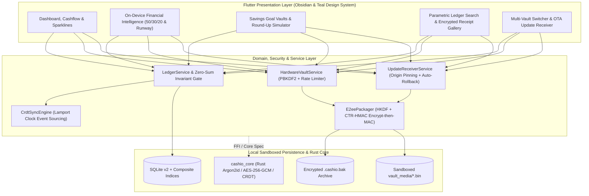

# Cash-IO

[](https://github.com/voidness-x/Cash-IO/actions/workflows/ci.yml)
[](https://github.com/voidness-x/Cash-IO/actions/workflows/security_audit.yml)
[](LICENSE)
[](SECURITY.md)

**Cash-IO** is an air-gapped, zero-knowledge, double-entry personal finance ledger engineered with Flutter and a Rust cryptographic/CRDT core. Every balance change obeys strict accounting invariants ($\sum \text{postings} = 0$), every vault is isolated behind salted PBKDF2/Argon2id key derivation and BIP-39 2048-word CSPRNG recovery phrases, and every over-the-air (OTA) update is guarded by pre-update encrypted snapshots (`.cashio.bak`) and automatic self-healing rollbacks.

---

## Key Capabilities

- **Strict Double-Entry Ledger Engine:** Atomic SQLite transactions where every entry requires $\ge 2$ balanced legs ($\sum \text{postings} = 0$) across Asset, Liability, Income, and Expense accounts, with integer minor-unit precision (zero floating-point rounding drift) and multi-currency support (`IQD`, `USD`, `EUR`, `GBP`, `SAR`, `AED`).
- **Multi-Vault Cryptographic Enclaves:** Create isolated vaults (Personal, Business, Emergency, or Decoy) with per-vault 256-bit random salts, PBKDF2-HMAC-SHA256 / Argon2id key derivation, 12-word BIP-39 recovery mnemonics, and 5-strike brute-force lockout protection.
- **100% On-Device Financial Intelligence:** Zero-telemetry heuristic engine computing 50/30/20 Needs/Wants/Savings ratios, emergency runway adequacy tiers, spending velocity spikes, and early-month envelope leak warnings without external API calls.
- **Locked Goal Vaults & Spare-Change Round-Up Simulator:** Purpose-driven savings vaults with discipline lock switches that block premature withdrawals and one-tap spare-change round-up transfers.
- **Encrypted Receipt Vault & Parametric Search:** Lossless encrypted receipt storage (`.bin` envelopes decrypted solely in ephemeral memory with 90° rotation & 5x zoom) paired with real-time full-text search, date-range scrubbers, and min/max amount filters.
- **Store-Independent OTA Update Receiver & Auto-Rollback:** Pulls signed release manifests from [GitHub Releases](https://github.com/voidness-x/Cash-IO/releases), enforces HTTPS origin pinning and SHA-256 payload verification, captures an automatic `.cashio.bak` snapshot prior to migration, and automatically rolls back if post-update ledger invariants fail.

---

## System Architecture



---

## Security & Cryptographic Posture

Cash-IO is designed around **Defense-in-Depth** and **Zero-Telemetry** principles. Full threat modeling, OWASP Top 10 mitigations, and vulnerability disclosure procedures are documented in [SECURITY.md](SECURITY.md).

| Control Domain | Implementation |
| :--- | :--- |
| **Authenticated Encryption** | HKDF-HMAC-SHA256 subkey separation (`enc` / `mac`) + 256-bit Counter-Mode PRF stream cipher + Encrypt-then-MAC (128-bit HMAC-SHA256 tag) in Dart; AES-256-GCM (`aes-gcm`) in `rust/src/crypto`. |
| **Key Derivation & Lockout** | 256-bit `Random.secure()` per-profile salt, iterated PBKDF2-HMAC-SHA256 (Dart isolate) / Argon2id 64 MiB (`rust`), constant-time verifier comparison, and 5-attempt service-layer lockout. |
| **Recovery Entropy** | 128-bit CSPRNG entropy mapped to the canonical 2,048-word BIP-39 English wordlist with SHA-256 checksum validation. |
| **OS & Side-Channel Hygiene** | `AppPrivacyShield` obscures multitasking snapshots on `inactive`/`paused`/`hidden`; `ClipboardSanitizer` zeroes sensitive clipboard contents after 30 seconds. |
| **Injection & Path Safety** | Parameterized SQLite queries, CWE-22 strict regex + `basename` validation on receipt blobs, and CWE-1236 formula neutralization on CSV exports. |
| **Supply-Chain & OTA Safety** | HTTPS host/repo pinning (`github.com/voidness-x/Cash-IO`), private/loopback/metadata IP SSRF blocking, anti-downgrade build checks, SHA-256 payload verification, and tamper-evident `.cashio.bak` rollback snapshots. |

---

## Mobile Releases & Automatic OTA Updates

Prebuilt mobile packages and signed OTA manifests are published automatically to **[GitHub Releases](https://github.com/voidness-x/Cash-IO/releases/latest)**:

- **Android (`cashio-vX.Y.Z-android.apk` Universal & `cashio-vX.Y.Z-android-arm64.apk` 64-bit Slim):**
  1. Download either `.apk` from [Releases](https://github.com/voidness-x/Cash-IO/releases/latest) onto your Android phone and install it (Play-Protect-compliant, `targetSdk 34`, signed with `v1 + v2 + v3` signature schemes).
  2. Every release is signed with the persistent Cash-IO RSA-4096 release certificate stored in GitHub Actions Encrypted Secrets, enabling seamless **in-place upgrades** without losing local vault data.
  3. Whenever a newer release is tagged on GitHub (e.g., `v3.1.0`), Cash-IO automatically detects it on app startup/resume, surfaces an update prompt on the Dashboard, creates a persistent `.cashio.bak` emergency snapshot, and launches Android's system APK updater.
- **iOS (`cashio-vX.Y.Z-ios-unsigned.ipa`):**
  - Built via macOS Xcode (`--no-codesign`) and packaged as an installable `.ipa` for sideloading via **AltStore**, **SideStore**, or **Sideloadly** (which re-sign the bundle with your personal Apple ID), or signing with an Apple Developer certificate.
- **Web / PWA (`cashio-vX.Y.Z-web.zip`):**
  - Standalone offline-ready PWA backed by persistent IndexedDB + `sqlite3.wasm`.

---

## Getting Started

### Prerequisites

- **Flutter SDK:** `>= 3.47.0` (Dart `^3.13.7`)
- **Rust Toolchain *(optional for native core development)*:** `stable` (`cargo`, `clippy`)

### Installation & Local Run

```bash
git clone https://github.com/voidness-x/Cash-IO.git
cd Cash-IO
flutter pub get

# Run on Web / Desktop
flutter run -d chrome
```

### Testing & Local Security Audit

Every pull request is gated on zero analyzer warnings/infos and 100% passage across all functional and adversarial security suites:

```bash
# Strict static analysis (zero infos, zero warnings)
flutter analyze --fatal-infos --fatal-warnings

# Run all unit, invariant, widget, and OWASP adversarial security tests
flutter test --concurrency=1

# Windows PowerShell full 5-stage DevSecOps audit
pwsh ./scripts/security_audit.ps1
```

---

## CI/CD & DevSecOps Pipelines

| Workflow | Trigger | Responsibilities |
| :--- | :--- | :--- |
| [`.github/workflows/ci.yml`](.github/workflows/ci.yml) | Push / PR | `flutter analyze --fatal-infos --fatal-warnings`, full Flutter test matrix with coverage, Web production build, and Rust `clippy` + `cargo test`. |
| [`.github/workflows/security_audit.yml`](.github/workflows/security_audit.yml) | Push / PR / Weekly Cron | **Gitleaks** git history secret scan, **Trivy** filesystem CVE & misconfiguration SARIF scan, **Google OSV-Scanner**, **RustSec `cargo-audit`**, **`cargo-deny`**, **SPDX SBOM** generation, and dedicated OWASP adversarial test gate. |
| [`.github/workflows/release_ota.yml`](.github/workflows/release_ota.yml) | Tag `v*.*.*` / Manual | Runs pre-release security gate, builds release bundle, generates `SHA256SUMS.txt` and signed `manifest.json`, and publishes OTA artifacts to GitHub Releases. |

---

## Repository Structure

```text
Cash-IO/
├── .github/workflows/       # CI, DevSecOps Security Audit & Automated OTA Release pipelines
├── lib/
│   ├── core/
│   │   ├── backup/          # Encrypted .cashio offline archive export & import
│   │   ├── commands/        # Immutable domain command contracts
│   │   ├── media/           # Sandboxed & encrypted receipt storage (CWE-22 hardened)
│   │   ├── models/          # Immutable ledger, envelope, recurring & savings models
│   │   ├── results/         # Sealed Result<S, E> functional error handling
│   │   ├── security/        # HardwareVaultService, CryptoIsolate, BIP-39, PrivacyShield, ClipboardSanitizer
│   │   ├── services/        # Ledger, Envelope, Advisory, Search & OTA UpdateReceiver services
│   │   ├── storage/         # SQLite v2 DatabaseHelper & multi-vault VaultRepository
│   │   ├── sync/            # Lamport-clock CRDT engine, E2EE packager & Google Drive appdata sync
│   │   └── theme/           # Obsidian & Teal (#00ABB3) design tokens and FrostedScaffold
│   └── features/            # Modular feature slices (dashboard, accounts, envelopes, forecast, advisory, savings, vaults, receipts, settings)
├── rust/                    # Rust core crate (Argon2id, AES-256-GCM, CRDT merge & zero-sum ledger)
├── scripts/                 # Local PowerShell DevSecOps audit runner
├── test/                    # 65+ unit, invariant, widget & OWASP adversarial vulnerability tests
├── CONTRIBUTING.md          # Engineering standards & PR security checklist
├── SECURITY.md              # Threat model, cryptographic spec & disclosure policy
└── STORE_COMPLIANCE.md      # Apple App Store, Google Play & EAR 5D992.c compliance declarations
```

---

## License

Distributed under the **MIT License**. See [LICENSE](LICENSE) for full text.
